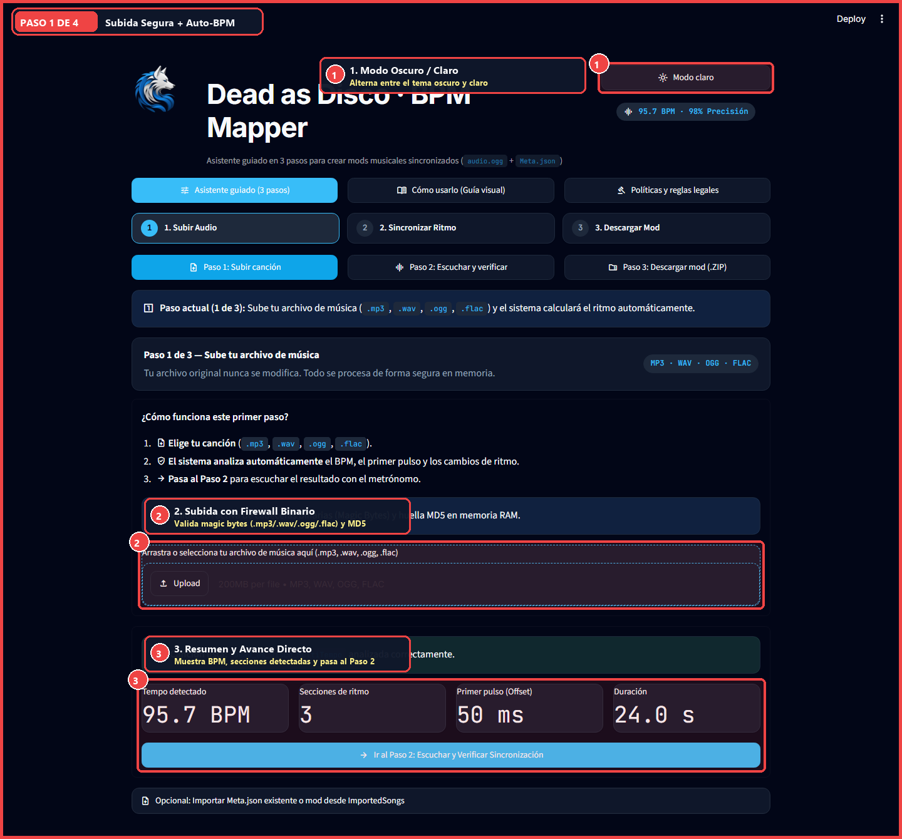
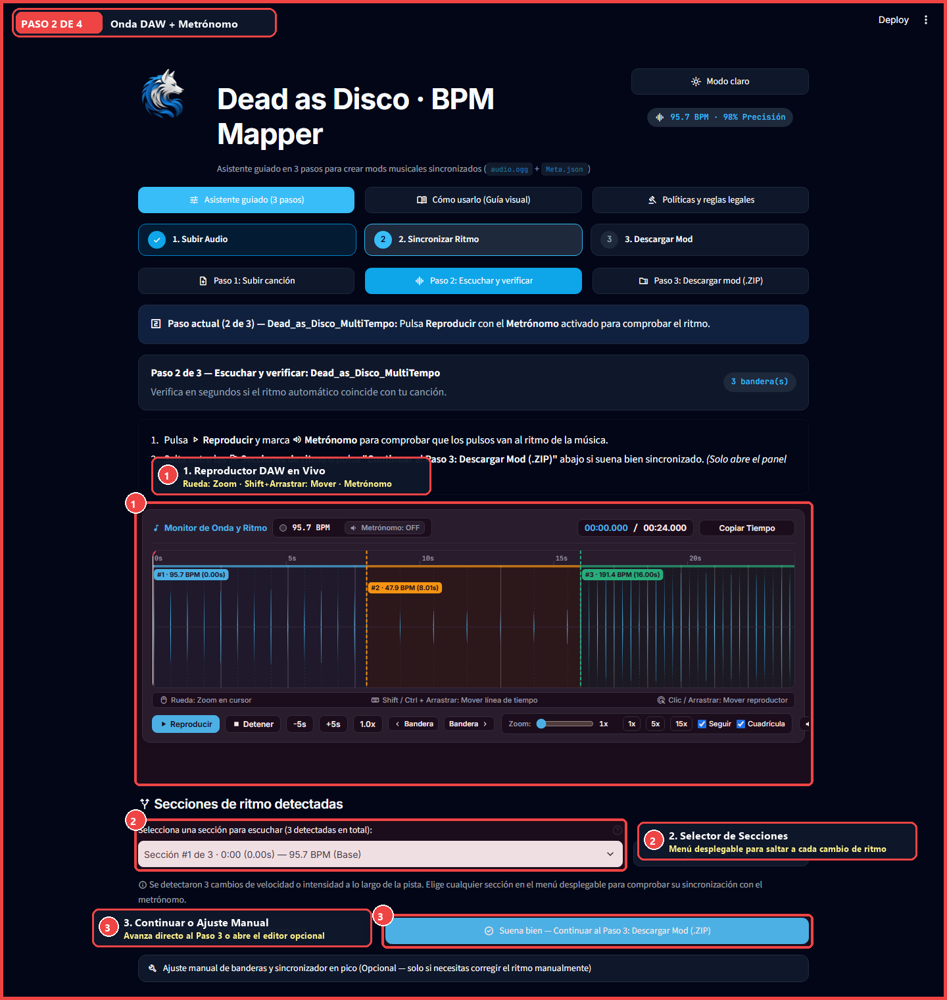
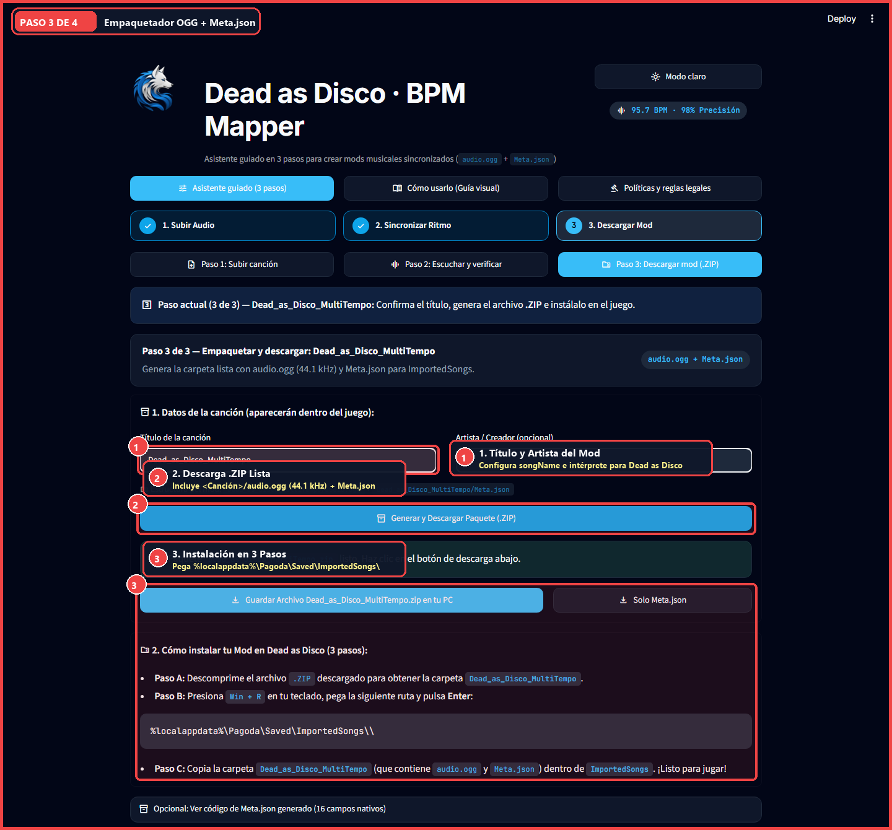
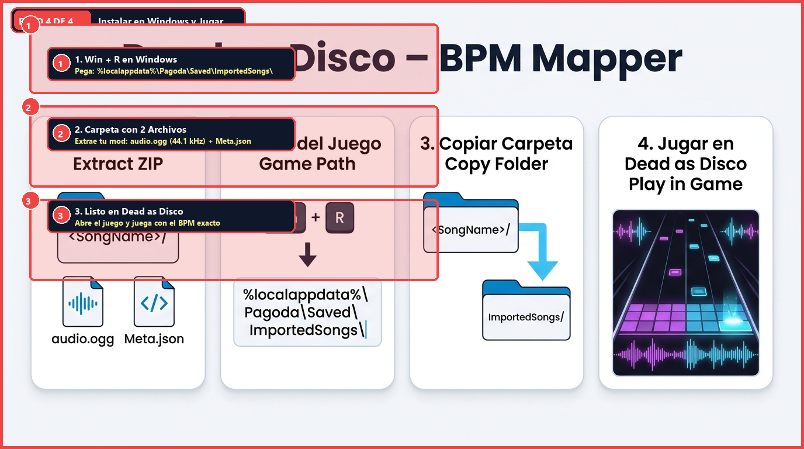

<div align="center">

**[Leer en Español](README.md)** | **[Read in English](README.en.md)**

  
  <h1>Dead as Disco — BPM & BeatSync Studio (v2)</h1>
  <p><b>Interactive web studio for precision BeatWarping synchronization and native custom song packaging</b></p>
</div>

---

## Purpose & Overview (Lead with the Outcome)

**Direct Outcome:** Turn any music track (`.mp3`, `.wav`, `.ogg`, `.flac`) into a native **Dead as Disco** mod package (`<SongName>/audio.ogg` at **44.1 kHz** + 16-field `<SongName>/Meta.json`), ready to unzip into `%localappdata%\Pagoda\Saved\ImportedSongs\`.

### Why This Tool Exists
When importing custom songs with tempo changes, asymmetric intros, or syncopated percussion directly into **Dead as Disco**, the game's built-in detector often assumes a static BPM or misaligns the initial downbeat (`beatOffset`), causing combat strikes and dodges to drift off-beat.

**Dead as Disco — BPM & BeatSync Studio v2** solves this limitation through:
1. **Non-Destructive DSP Analysis (Librosa)**: Automatically detects root `tempo`, exact millisecond `beatOffset`, and dynamic tempo shifts (`customTempoSections`).
2. **Magnetic Transient Peak Alignment**: Snaps tempo flags directly to real acoustic transients (kick/snare peaks) and auto-calculates section BPM when set to `BPM = 0`.
3. **Zero-Drift Native Packaging**: Transcodes a clean copy to `audio.ogg` (**44,100 Hz**) to eliminate MP3 encoder padding while preserving the untouched source MD5 hash (`originalAudioFileHash`).

---

## Quick Path

1. **Upload Track (Step 1)**: Upload your audio file through the binary magic-byte security firewall.
2. **Sync Rhythm (Step 2)**: Verify the first downbeat (`beatOffset`) and tempo sections on the live waveform player with WebAudio metronome and beat grid.
3. **Export Mod (Step 3)**: Download the `<SongName>.zip` bundle (or export directly) into `%localappdata%\Pagoda\Saved\ImportedSongs\`.

---

## Step-by-Step Visual Guide

### Step 1: Upload Audio Validated by Binary Firewall
Upload your music track (`.mp3`, `.wav`, `.ogg`, `.flac`) and optionally an existing `Meta.json` file. The engine inspects binary magic-byte headers before decoding and computes the original MD5 hash without mutating your source file.

<div align="center">
  
</div>

### Step 2: Verify & Synchronize with Acoustic Peaks and Beat Grid
Play the track at 60 FPS on the interactive waveform canvas featuring up to `25x` zoom, WebAudio metronome clicks, and a visual beat grid. Fine-tune `beatOffset` (ms), `startSongOffset`/`endSongOffset` (s), jump across sections (`◀ Previous` / `Next ▶`), or enter `BPM = 0` to auto-compute exact peak-to-peak tempo.

<div align="center">
  
</div>

### Step 3: Generate & Download `.ZIP` with `audio.ogg` + `Meta.json`
Review the package audit (`fitQuality` score, tempo sections, and live `Meta.json` preview). Generate the `.zip` bundle with 44.1 kHz `audio.ogg` audio or export directly to your local game directory.

<div align="center">
  
</div>

### Step 4: Unzip into `ImportedSongs` & Play in Game
Extract the `<SongName>/` folder into `%localappdata%\Pagoda\Saved\ImportedSongs\`. Launch **Dead as Disco** and play your custom track with frame-accurate synchronization.

<div align="center">
  
</div>

---

## Official Output Format (`Meta.json` + `audio.ogg`)

Every exported package produces the exact folder structure expected by Unreal Engine / Pagoda:

```text
%localappdata%\Pagoda\Saved\ImportedSongs\
└── <SongName>\
    ├── audio.ogg   # 44,100 Hz Ogg Vorbis audio (zero encoder-padding drift)
    └── Meta.json   # Tab-indented (\t) native 16-field Pagoda metadata contract
```

### 16-Field `Meta.json` Schema Contract

| # | Field | Type | Description |
| :- | :--- | :--- | :--- |
| 1 | `version` | `int` | Pagoda metadata schema version (`1`). |
| 2 | `uniqueId` | `int` | Unique unsigned 32-bit numeric song identifier. |
| 3 | `songName` | `str` | Display title of the song inside the game. |
| 4 | `performedBy` | `list[str]` | Performing artists list. |
| 5 | `writtenBy` | `list[str]` | Songwriters or composers list. |
| 6 | `seed` | `int` | Deterministic 32-bit seed for procedural game elements. |
| 7 | `tempo` | `float \| int` | Root BPM of the track (initial section starting at `0.0s`). |
| 8 | `customTempoSections` | `list[dict]` | Dynamic tempo changes (`{"tempo", "startAbsoluteTime"}`). |
| 9 | `beatOffset` | `int` | First downbeat offset in **milliseconds** (`ms`). |
| 10 | `startSongOffset` | `float` | Effective playback start offset in **seconds** (`s`). |
| 11 | `endSongOffset` | `float` | Playback end trim offset in **seconds** (`s`). |
| 12 | `uEAssetName` | `str` | Internal Unreal Engine asset identifier string. |
| 13 | `originalAudioFileHash` | `str` | 32-character lowercase **MD5** hex digest of raw source bytes. |
| 14 | `originalAudioFilePath` | `str` | Reference path of the original source audio file. |
| 15 | `analyseResult` | `dict` | Analysis diagnostics (`bAnalyseSuccessful`, `bFoundTempo`, `bFoundOffset`, `tempo`, `beatOffset`, `fitQuality`, `errorCode`). |
| 16 | `beatTracks` | `list` | Choreography beat tracks array (reserved as `[]`). |

### Sample `Meta.json` Output

```json
{
	"version": 1,
	"uniqueId": 27605225,
	"songName": "Neon Rave Act I",
	"performedBy": [],
	"writtenBy": [],
	"seed": 2196372576,
	"tempo": 95,
	"customTempoSections": [
		{
			"tempo": 190,
			"startAbsoluteTime": 20.248838
		}
	],
	"beatOffset": 38,
	"startSongOffset": 0.85,
	"endSongOffset": 210.0,
	"uEAssetName": "Neon Rave Act I",
	"originalAudioFileHash": "84e43bfb431159bcf29ab6ab906a4147",
	"originalAudioFilePath": "D:/Music/Neon Rave Act I.mp3",
	"analyseResult": {
		"bAnalyseSuccessful": true,
		"bFoundTempo": true,
		"bFoundOffset": true,
		"tempo": 95,
		"beatOffset": 38,
		"fitQuality": 0.920423,
		"errorCode": {
			"code": 0,
			"messageKey": "None",
			"message": ""
		}
	},
	"beatTracks": []
}
```

---

## S.O.L.I.D Modular Architecture (`< 400` Lines per File)

The codebase enforces strict Single Responsibility (**S.O.L.I.D**) and an automated architectural gate guaranteeing **every file stays strictly under 400 lines of code** (`tests/test_architecture_limits.py`). Domain layers (`models/`, `audio_analysis/`, `export/`) have zero dependency on Streamlit.

```text
├── app.py                          # Thin navigation and session-state orchestrator (< 200 LOC)
├── models/
│   └── song_metadata.py            # 16-field Meta.json dataclasses & legacy BPMSection bridge
├── audio_analysis/
│   ├── security.py                 # Binary magic-byte upload firewall + raw MD5 hashing
│   ├── dsp_peaks.py                # DSP loader, envelope, transient snapping & Zero-BPM solver
│   ├── beat_detection.py           # Global tempo, beatOffset (ms), and fitQuality analysis
│   ├── bpm_sections.py             # Section CRUD and continuous BeatWarping math
│   ├── converter.py                # Non-destructive 44.1 kHz OGG transcoder (FFmpeg/SoundFile)
│   └── exceptions.py               # Domain and security exception hierarchy
├── export/
│   ├── package_builder.py          # ZIP packager (<SongName>/Meta.json + audio.ogg) & local exporter
│   └── exceptions.py               # Export I/O exception types
├── ui/
│   ├── theme.py                    # Sky/Slate design system (:root CSS, Inter + JetBrains Mono)
│   ├── step_upload.py              # Wizard Step 1: secure upload & Meta.json import
│   ├── step_sync.py                # Wizard Step 2: live sync player & peak auto-calibration
│   ├── step_export.py              # Wizard Step 3: Meta.json preview & ZIP export
│   ├── live_waveform_player.py     # Streamlit bridge for the interactive waveform player
│   ├── player_assets.py            # HTML5 Canvas + WebAudio Metronome + Beat Grid template
│   ├── flag_editor.py              # Interactive editor for offsets and customTempoSections
│   ├── waveform_view.py            # Static Matplotlib fallback waveform chart
│   ├── guide_view.py               # Built-in visual guide view with annotated screenshots
│   └── legal_view.py               # Security, Privacy, and Legal (DMCA) policy view
└── tests/                          # Unit, <400 LOC architectural gate, and E2E test suites
```

| Layer | Package | Core Responsibility | UI Dependency |
| :--- | :--- | :--- | :---: |
| **Domain** | `models/` | Typed `SongMetadata`, `CustomTempoSection`, `AnalyseResult`, and legacy migration. | None |
| **Security & DSP** | `audio_analysis/` | Magic-byte firewall, untouched MD5, peak/BPM detection, and 44.1 kHz OGG conversion. | None |
| **Packaging** | `export/` | 16-field `Meta.json` serialization and `<SongName>/` `.zip` archive builder. | None |
| **Presentation** | `ui/` + `app.py` | Minimalist 3-step Wizard, Sky/Slate theme, 60 FPS Canvas player, and Guide/Legal tabs. | Streamlit |

---

## Installation, Local Execution & Testing

### 1. Prerequisites
- **Python 3.10+** (Python 3.12 recommended).
- **FFmpeg** installed on your system (with automatic `soundfile` / `libsndfile` fallback):
  ```bash
  winget install Gyan.FFmpeg
  ```

### 2. Install & Run Locally
```bash
git clone https://github.com/victortelles/DaD-BPM-Mapper.git
cd DaD-BPM-Mapper
pip install -r requirements.txt
streamlit run app.py
```

### 3. Automated Testing (Pytest + Architectural Audit + E2E)
```bash
# Run the complete unit, security, <400 LOC architecture, and E2E test suite
pytest -q

# Run the architectural gate and end-to-end v2 workflow verification explicitly
pytest tests/test_architecture_limits.py tests/test_e2e_workflow.py -v
```

### Verification Checklist
- [x] Every file in the repository is strictly `< 400` lines of code.
- [x] Disguised executables (`MZ`) and scripts (`<script>`) are blocked by the upload firewall.
- [x] Exported `.zip` archives contain `<SongName>/audio.ogg` (44.1 kHz) and `<SongName>/Meta.json` (16 fields).

---

## Security, Privacy & Legal Disclaimer (DMCA)

- **Binary Upload Firewall**: Only `.mp3`, `.wav`, `.ogg`, and `.flac` files (`64 B` to `100 MB`) with authentic binary magic-byte headers (`ID3`/MPEG sync, `RIFF`/`WAVE`, `OggS`, `fLaC`) are accepted. Renamed executables or scripts are rejected before reaching any audio decoder.
- **100% Ephemeral & Non-Destructive Processing**: Uploaded tracks are processed in memory or isolated temporary directories. Original files are never modified, preserving their exact `originalAudioFileHash` (MD5).
- **Intellectual Property & DMCA**: This project is a non-commercial community modding utility and is not affiliated with or endorsed by the creators of **Dead as Disco** (*Pagoda*). Users are solely responsible for owning the rights or licenses to any music files processed locally for personal use.
