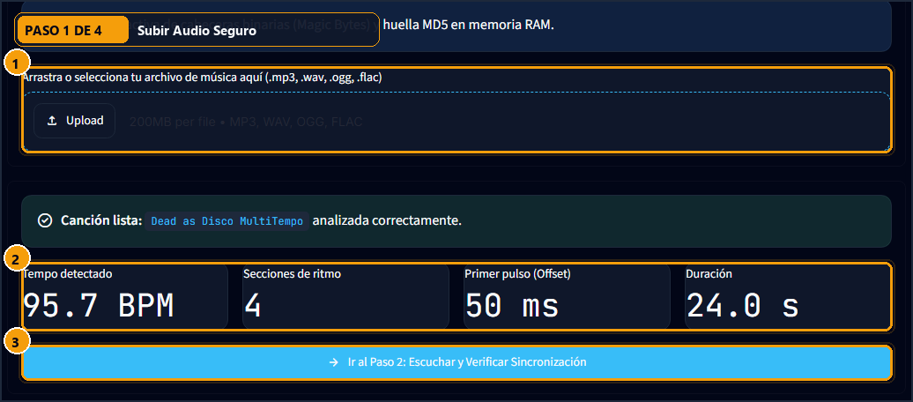
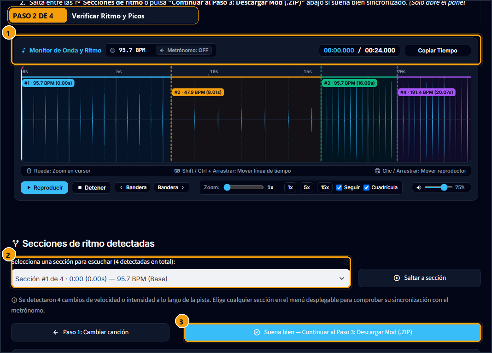
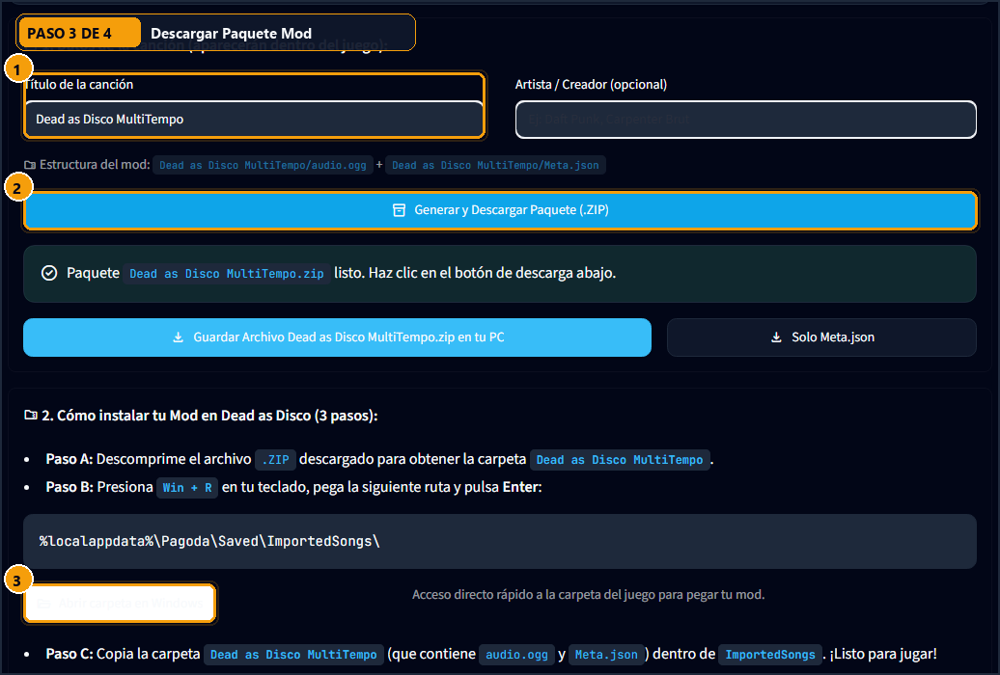
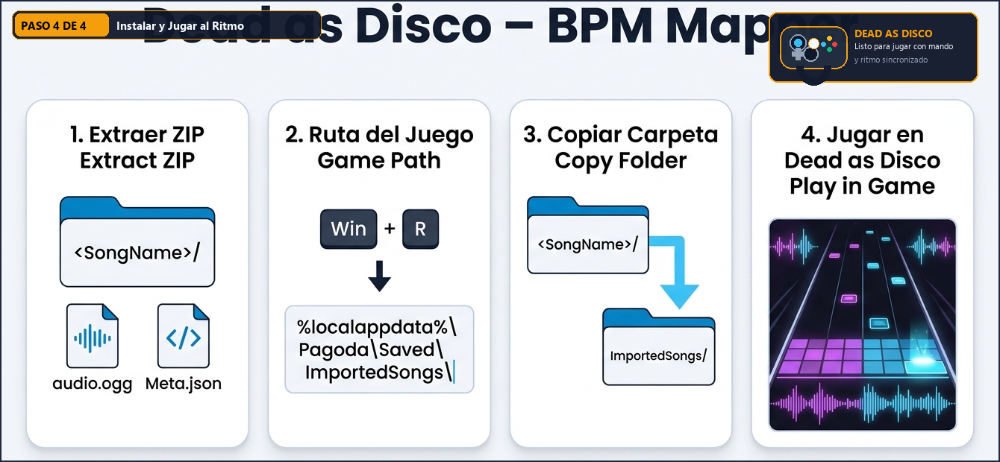

<div align="center">

**[Leer en Español](README.md)** | **[Read in English](README.en.md)**

  
  <h1>Dead as Disco — BPM & BeatSync Studio (v2)</h1>
  <p><b>Aplicacion web hecha con framework streamlit para la sincronizacion ritmica de precision para el videojuego de Dead as Disco </b></p>
</div>

---

## Propósito y Solución (Lead with the Outcome)

**Resultado directo:** Convierte cualquier pista musical (`.mp3`, `.wav`, `.ogg`, `.flac`) en un paquete de mod nativo para **Dead as Disco** (`<SongName>/audio.ogg` a **44.1 kHz** + `<SongName>/Meta.json` de **16 campos**), listo para descomprimir en `%localappdata%\Pagoda\Saved\ImportedSongs\`.

### ¿Por qué existe esta herramienta?
Cuando importas canciones con cambios de ritmo, introducciones asimétricas o percusiones síncopas directamente en **Dead as Disco**, el detector interno del juego suele asumir un BPM estático o desfasar el primer golpe (`beatOffset`), provocando que los ataques y esquives pierdan sincronía con la música.

**Dead as Disco — BPM & BeatSync** resuelve esta limitación mediante:
1. **Análisis DSP No Destructivo (Librosa)**: Detecta el `tempo` raíz, el `beatOffset` exacto en milisegundos y cambios dinámicos de velocidad (`customTempoSections`).
2. **Alineación Magnética a Picos Acústicos**: Permite anclar banderas de tempo directamente a los transitorios reales (golpes de bombo/caja) y recalcular BPMs automáticamente poniendo `BPM = 0`.
3. **Empaquetado Nativo sin Desfase**: Transcodifica una copia limpia a `audio.ogg` (**44,100 Hz**) eliminando el *encoder padding* del MP3 y preservando intacto el hash MD5 del archivo original (`originalAudioFileHash`).

---

## Ruta Rápida (Quick Path)

1. **Subir canción (Paso 1)**: Carga tu archivo de audio validado por el firewall binario de cabeceras mágicas.
2. **Escuchar y verificar (Paso 2)**: Verifica el golpe inicial (`beatOffset`) y las secciones de tempo en el reproductor en vivo con metrónomo y cuadrícula de beats.
3. **Descargar mod (Paso 3)**: Descarga el archivo `<SongName>.zip` (o abre la carpeta directamente) en `%localappdata%\Pagoda\Saved\ImportedSongs\`.

---

## Guía Visual Paso a Paso

### Paso 1: Subir Audio
Sube tu pista musical (`.mp3`, `.wav`, `.ogg`, `.flac`) y, opcionalmente, un archivo `Meta.json` previo. El motor verifica la firma binaria real (*magic bytes*) antes de decodificar la señal y calcula el hash MD5 original sin alterar tus archivos.

<div align="center">
  
</div>

### Paso 2: Verificar y Sincronizar con Picos Acústicos y Cuadrícula de Beats
Reproduce la canción a 60 FPS sobre la forma de onda interactiva con zoom de hasta `25x`, metrónomo WebAudio y rejilla visual de pulsos. Ajusta `beatOffset` (ms), `startSongOffset`/`endSongOffset` (s), navega entre secciones (`◀ Anterior` / `Siguiente ▶`) o escribe `BPM = 0` para que el motor calcule el tempo exacto entre picos.

<div align="center">
  
</div>

### Paso 3: Generar y Descargar `.ZIP` con `audio.ogg` + `Meta.json`
Revisa la auditoría del paquete (calidad de ajuste `fitQuality`, secciones detectadas y vista previa de `Meta.json`). Genera el paquete `.zip` con el audio transcodificado a `audio.ogg` (44.1 kHz) o expórtalo directamente a la carpeta local del juego.

<div align="center">
  
</div>

### Paso 4: Descomprimir en `ImportedSongs` y Jugar
Extrae la carpeta `<SongName>/` dentro de `%localappdata%\Pagoda\Saved\ImportedSongs\`. Inicia **Dead as Disco** y selecciona tu pista perfectamente sincronizada.

<div align="center">
  
</div>

---

## Formato Oficial de Salida (`Meta.json` + `audio.ogg`)

Cada paquete exportado genera la estructura exacta requerida por Unreal Engine / Pagoda:

```text
%localappdata%\Pagoda\Saved\ImportedSongs\
└── <SongName>\
    ├── audio.ogg   # Audio Ogg Vorbis a 44,100 Hz (sin padding de compresión)
    └── Meta.json   # Contrato nativo de 16 campos indentado con tabulaciones (\t)
```

### Contrato de 16 Campos de `Meta.json`

| # | Campo | Tipo | Descripción |
| :- | :--- | :--- | :--- |
| 1 | `version` | `int` | Versión del esquema de metadatos de Pagoda (`1`). |
| 2 | `uniqueId` | `int` | Identificador numérico único de 32 bits sin signo. |
| 3 | `songName` | `str` | Título visible de la canción dentro del juego. |
| 4 | `performedBy` | `list[str]` | Lista de intérpretes o artistas. |
| 5 | `writtenBy` | `list[str]` | Lista de compositores o autores. |
| 6 | `seed` | `int` | Semilla determinista de 32 bits para generación procedural. |
| 7 | `tempo` | `float \| int` | BPM base de la canción (sección inicial desde `0.0s`). |
| 8 | `customTempoSections` | `list[dict]` | Cambios dinámicos de tempo (`{"tempo", "startAbsoluteTime"}`). |
| 9 | `beatOffset` | `int` | Desfase del primer pulso rítmico en **milisegundos** (`ms`). |
| 10 | `startSongOffset` | `float` | Tiempo de inicio de reproducción efectiva en **segundos** (`s`). |
| 11 | `endSongOffset` | `float` | Tiempo de corte final en **segundos** (`s`). |
| 12 | `uEAssetName` | `str` | Nombre del recurso interno para Unreal Engine. |
| 13 | `originalAudioFileHash` | `str` | Hash **MD5** hexadecimal (32 caracteres) de los bytes originales. |
| 14 | `originalAudioFilePath` | `str` | Ruta de referencia del archivo de audio de origen. |
| 15 | `analyseResult` | `dict` | Diagnóstico (`bAnalyseSuccessful`, `bFoundTempo`, `bFoundOffset`, `tempo`, `beatOffset`, `fitQuality`, `errorCode`). |
| 16 | `beatTracks` | `list` | Pistas de eventos coreográficos (reservado como `[]`). |

---

## Instalación, Ejecución Local y Pruebas

### 1. Prerrequisitos
- **Python 3.10+** (recomendado Python 3.12).
- **FFmpeg** instalado en el sistema (con respaldo automático vía `soundfile` / `libsndfile`):
  ```bash
  winget install Gyan.FFmpeg
  ```

### 2. Instalación y Ejecución
```bash
git clone https://github.com/victortelles/DaD-BPM-Mapper.git
cd DaD-BPM-Mapper
pip install -r requirements.txt
streamlit run app.py
```

### 3. Suite de Pruebas (Pytest + Auditoría Arquitectónica + E2E)
```bash
# Ejecutar toda la suite unitaria, de seguridad, arquitectura (<400 LOC) y E2E
pytest -q

# Ejecutar específicamente el gate arquitectónico y el flujo E2E v2
pytest tests/test_architecture_limits.py tests/test_e2e_workflow.py -v
```

---

## Políticas de Seguridad, Privacidad y Aviso Legal (DMCA)

- **Privacidad de Datos (Cero Recopilación)**: La aplicación no toma, recopila ni guarda datos de los usuarios. Lo único que utiliza es el archivo de audio que proporcionas para procesar la sincronización rítmica en la memoria RAM local, sin almacenarlo en ninguna base de datos ni servidor externo.
- **Firewall Binario de Subida**: Solo se aceptan extensiones `.mp3`, `.wav`, `.ogg` y `.flac` (entre `64 B` y `100 MB`) cuyas cabeceras binarias coincidan con firmas reales (`ID3`/MPEG sync, `RIFF`/`WAVE`, `OggS`, `fLaC`). Cualquier binario ejecutable o script camuflado es bloqueado antes de tocar el decodificador.
- **Procesamiento 100% Efímero y No Destructivo**: Los archivos de audio se procesan en memoria RAM o directorios temporales aislados. El archivo original jamás es modificado y su hash MD5 (`originalAudioFileHash`) se preserva íntegro.
- **Propiedad Intelectual y DMCA**: Este proyecto es una utilidad comunitaria de *modding* sin fines comerciales ni afiliación oficial con los creadores de **Dead as Disco**. El usuario es el único responsable de poseer los derechos o licencias de las pistas musicales que procese localmente para uso personal.
